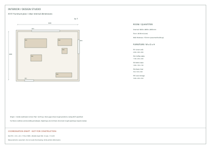
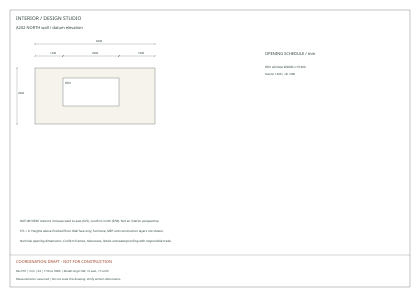
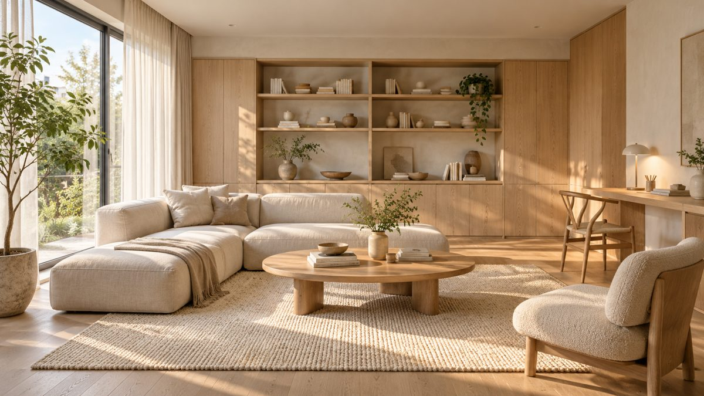
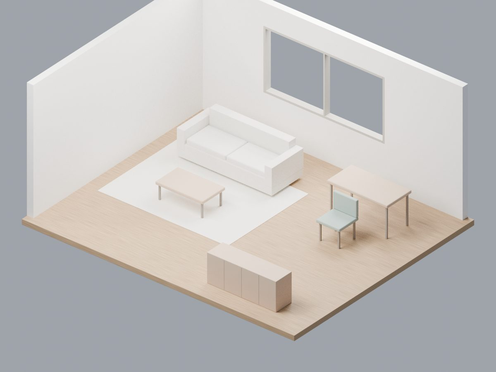

# Interior Design Skill

**把心中想要的空間，變成可修改的 Blender 模型、互動前端，以及能和室內設計師、工程師、工班溝通的尺寸圖。**

[English](README.md) · 繁體中文

免費、本機優先的 Agent Skill。先整理需求、尺寸與參考圖，確認草模，再逐輪修改。模型、圖面與表格共用同一份專案資料。Agent 或 LLM 服務可能另有費用；核心流程不需要付費生成 API。

目前是可運行的**單房原型**，家具為風格化示意體塊。產出的圖面是**協調草圖，施工前需要專業審查**。

## 實際交付圖面長這樣

以下是生成工具實際產出的合成房間範例，版次 **P01**。點圖可放大查看尺寸、圖號與圖框。

### A101 · 尺寸家具配置平面圖

[](docs/drawings/A101.svg)

同一張圖呈現房間內淨尺寸、家具位置與編號、名義門窗定位、版本、單位及列印比例。

### A202 · 北側牆面基準立面圖

[](docs/drawings/A202.svg)

可核對牆長、淨高、窗寬與窗台位置。這張基準立面用於門窗定位；櫃體與機電細節仍需另行深化。

**下載實際範例：**[五頁 A3 PDF 圖冊](docs/drawings/drawings.pdf) · [可編輯平面 DXF](docs/drawings/plan.dxf) · [家具尺寸表 CSV](docs/drawings/furniture.csv)。

PDF 包含 A101 平面及 A201–A204 四向牆面立面。列印請選 A3、100%，並以各張圖框的比例為準。這些尺寸協調圖可用來與設計師、工程師及工班對圖討論。

## 呈現預覽

[](docs/images/fictional-concept.png)

**AI 概念研究**：虛構房間，用來表達材質、光線與構圖。這張獨立圖片並非範例 Blender 場景的渲染，不能作為幾何或尺寸正確的證據。點擊預覽可開啟原始 PNG。

[](docs/assets/demo-render.png)

**實際 Blender 輸出**：合成範例房間的 1920×1440 模型渲染，可透過隨附工具重現。

## 安裝 skill

```bash
npx skills add vic4code/interior-design-skill --skill interior-design
```

也可以將完整的 [skills/interior-design](skills/interior-design/) 資料夾複製到 agent 的 skill 目錄。`SKILL.md`、參考文件、程式、schema、範例和 viewer 隨 skill 一起安裝。見 [agent 相容性](docs/agent-compatibility.md)；各平台獨立對話實測仍待進行。

可以這樣開始：

> 使用 interior-design skill。幫我把房間想法做成 Blender 模型，以及可以和設計師、工程師討論的尺寸圖。先整理需求、尺寸與參考圖，標出假設，讓我確認第一版草模，再進一步細化。

## 在本機跑範例

先安裝 Python 3.11+、Node.js 20.19+ 或 22.12+、Blender 4.3+，並把 `blender` 加入 PATH。下載 repo 後執行：

```bash
git clone https://github.com/vic4code/interior-design-skill.git
cd interior-design-skill/skills/interior-design
bash scripts/setup.sh
.venv/bin/python scripts/project.py build assets/example-project.json --out assets/viewer/public/generated --blender
npm --prefix assets/viewer run dev
```

開啟 Vite 顯示的本機網址，即可看渲染、3D、平面與下載檔案。首次安裝需要網路；依賴安裝完成後可在本機生成與展示。若已安裝 skill，從它自己的資料夾執行相同指令，省略 clone 與 `cd`。

沒有 Blender 時移除 `--blender`，即可產生圖面並使用平面檢視。Windows 可使用 WSL。原生 PowerShell 請用 `py -m venv .venv` 建環境，以 `.venv\Scripts\python -m pip install -r scripts/requirements.lock.txt` 安裝 Python 依賴，再執行 `npm --prefix assets/viewer ci --ignore-scripts`；後續 Python 指令改用 `.venv\Scripts\python`。

## 你會拿到什麼

| 用途 | 輸出 | 現階段內容 |
| --- | --- | --- |
| 討論風格與比例 | 1920×1440 PNG | 本機 Blender Cycles 剖切視圖；可另外算 4K |
| 檢視與修改空間 | `.blend`、GLB、互動前端 | 真實尺寸幾何、門窗洞口、示意家具與相機控制 |
| 討論配置 | A101 平面圖 | mm 尺寸、家具編號與門窗 |
| 討論牆面定位 | A201–A204 基準立面 | 牆長、淨高、門窗尺寸與位置 |
| 帶到會議或 CAD 修改 | 五頁 A3 PDF、SVG、平面 DXF | 各張標示比例；DXF 使用 model-space mm |
| 追蹤決策與數量 | JSON、CSV、交付說明、manifest | 尺寸、淨面積、待確認項目與 SHA-256 |

多數圖面為 1:50；A101 深度超過 8000 mm 時改用 1:100，以各張圖框為準。平面表只列前十件家具，完整清單見 `furniture.csv`。DXF 尺寸不是 CAD 原生關聯尺寸。

## 建立自己的房間

有尺寸平面圖就能開始，照片用來補充現況。手繪草圖需補牆長與門窗位置；只有照片時先做概念，可靠對尺寸仍需量測。Agent 負責整理輸入，目前生成器不會自動辨識任意照片或 PDF。

複製 `assets/example-project.json` 為自己的專案檔，修改需求、房間尺寸、門窗與家具。全部尺寸使用 mm。從 skill 資料夾執行：

```bash
.venv/bin/python scripts/project.py validate /path/to/my-room.json
.venv/bin/python scripts/project.py build /path/to/my-room.json --out /path/to/my-review --blender
```

提供喜歡的家具連結、確切型號或截圖，skill 會引導 agent 查核原廠尺寸與安裝距離、記錄來源，並標示近似模型。選配的 AI 圖像與模型底圖分開呈現。疊圖、機電協調已有工作流程說明；圖層切換、原圖配準與完整機電設計仍待實作。

參考 [資料準備](skills/interior-design/references/intake.md)、[家具查證](skills/interior-design/references/furniture-sourcing.md)、[渲染與 AI 圖像](skills/interior-design/references/render-and-imagegen.md)、[疊圖與機電](skills/interior-design/references/overlays-and-mep.md)、[專案格式](skills/interior-design/references/project-format.md) 及 [工程圖交付](skills/interior-design/references/drawing-handoff.zh-TW.md)。

若要另外產生 4K 渲染，從 skill 資料夾執行：

```bash
blender -b /path/to/my-review/scene.blend --threads 2 --python-exit-code 1 --python scripts/render_hd.py -- --width 3840 --height 2880 --samples 128 --out /path/to/my-review/final-4k.png
```

這不會改動原始場景與 manifest 的原圖。增加像素不會增加幾何細節，也不代表圖面已可施工。

## 套件架構與開發

依 [Anthropic skill-creator](https://github.com/anthropics/skills/tree/main/skills/skill-creator) 慣例，將逐步載入的指令與資源放在同一個 skill 資料夾。

```text
skills/interior-design/
├── SKILL.md
├── agents/                 # 選用的 host 顯示資訊
├── references/             # 工作流程與格式說明
├── scripts/                # 安裝、生成與驗證程式
└── assets/                 # Schema、合成範例與 viewer
```

從 repo 根目錄執行測試：

```bash
skills/interior-design/.venv/bin/python -m unittest discover -s tests -v
```

產生範例後，從 skill 資料夾驗證並建置前端：

```bash
.venv/bin/python scripts/verify_outputs.py assets/viewer/public/generated
npm --prefix assets/viewer run build
```

選用的 browser smoke script 需要 Python Playwright 與 Chromium。生成專案預設不進 Git；公開建置請排除私人內容。開發伺服器沒有認證，請在可信任的本機環境使用。實際驗證狀態見 [verification](docs/verification.md)。

## 範圍與後續方向

目前支援單矩形房間，最大 10×10 m、淨高 2–5 m；家具各邊至少 150 mm。不支援多房、不規則牆、家具旋轉、自動照片量測或自然語言直接解析 JSON。Agent 會把對話轉成可驗證資料。Viewer 用來檢視與下載，拖拉編輯仍待實作。

後續方向包含細緻資產、日常操作控制、多視角、校正疊圖及複雜房型；目前未整合 BIM/IFC。見 [設計方法](docs/design-patterns.md)、[實作規劃](docs/implementation-roadmap.md) 與 [研究及來源](docs/research.md)。

原創程式與合成範例採 [MIT](LICENSE)。第三方資產需記錄來源、作者、授權及可再散布範圍。貢獻方式見 [CONTRIBUTING.md](CONTRIBUTING.md)。
