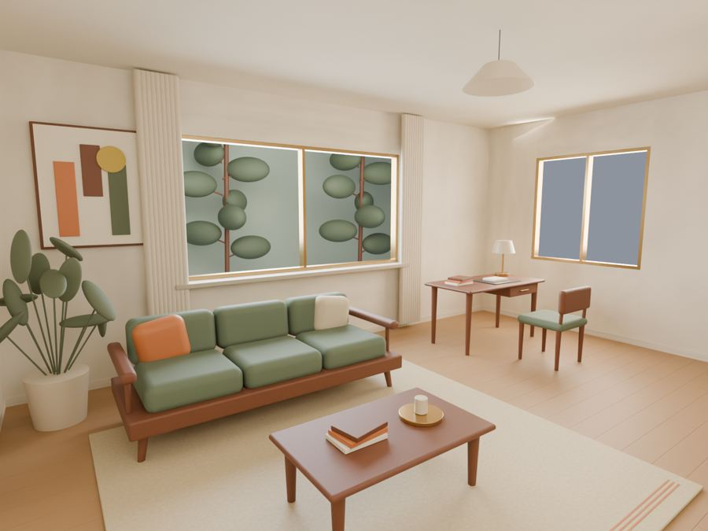
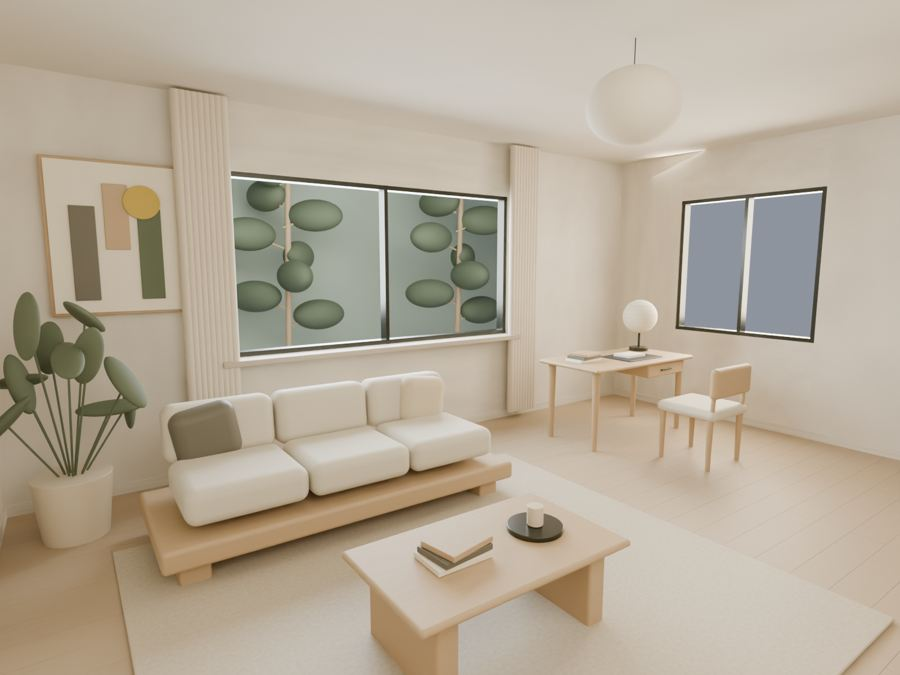
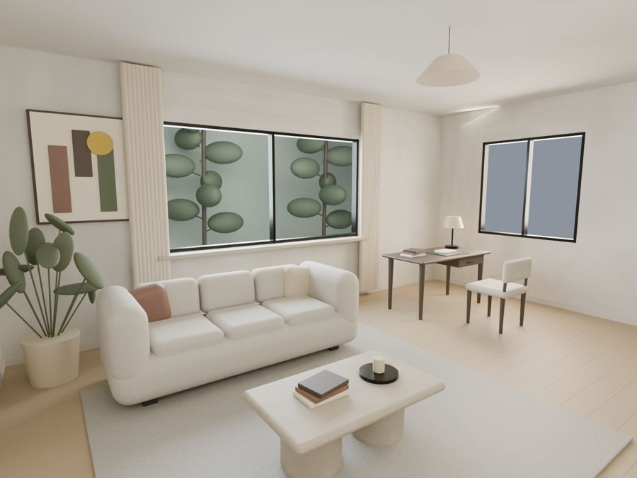
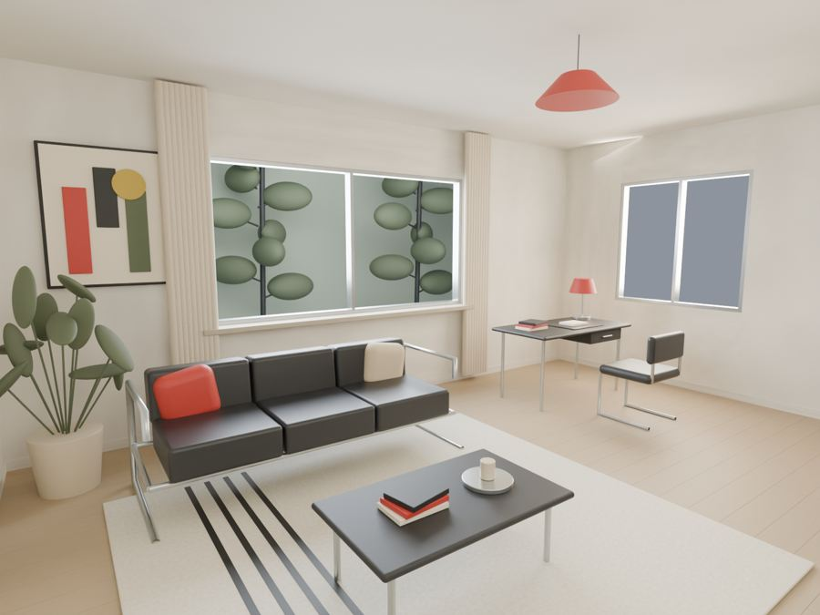

# Interior Design Skill

**把想像的空間，做成可修改的模型、完整風格呈現，以及能跟設計師與師傅逐項對圖的交付文件。**

[English](README.md) · 繁體中文

支援 **Codex、Claude Code、Cursor、GitHub Copilot** 的標準 Agent Skill。從平面圖、參考案例與選物連結出發，用 Blender 與前端檢視配置、家具、材質、燈光及施工介面。本機核心不需要付費生成 API。

## 四種風格，都是實際 Blender 輸出

同一個原創合成客廳／工作空間，透過四種不同家具造型、材質與選物組合呈現。以下皆是**模型直接渲染**，可重建原生場景、匯出 GLB，並保留相機與來源雜湊。

| Mid-century Modern／MCM | Japandi／日系北歐 |
| --- | --- |
| [](docs/showcase/mcm/hero.jpg) | [](docs/showcase/japandi/hero.jpg) |
| 木框、細腳、橄欖綠與鏽橘，搭配有層次的復古選物。 | 低平台、淺橡木、亞麻、礦物感牆面與柔光。 |
| **Contemporary／當代現代** | **Bauhaus／包浩斯** |
| [](docs/showcase/contemporary/hero.jpg) | [](docs/showcase/bauhaus/hero.jpg) |
| 圓潤布面、整塊量體與節制的材質對比。 | 金屬管架、黑色布面與紅黃藍幾何點綴。 |

點圖可看完整尺寸。家具、材質與畫作均為原創程序建模。詳見[風格決策、來源與重建方式](skills/interior-design/references/style-studies.md)。[Lo-Fi House 案例](https://lofi-house.com/cases/)與 [Dan Retro 選物](https://www.danretro.com/products)用來研究風格與選品流程，未將案例照片或商業模型打包再散布。

## 實際交付圖面長這樣

同一份空間與櫃體尺寸，產出完整 **8 張 A3 圖冊**：尺寸定位、門窗、燈位／插座提案、室內立面、櫃體三視圖、剖面、材料尺寸表及待確認事項。

| 尺寸配置平面 · A101 | 櫃體三視圖 · J301 |
| --- | --- |
| [](docs/showcase/drawings/A101.svg) | [](docs/showcase/drawings/J301.svg) |
| **櫃體剖面與施工介面 · J401** | **燈位與插座提案 · A102** |
| [](docs/showcase/drawings/J401.svg) | [](docs/showcase/drawings/A102.svg) |

**下載交付範例：**[完整 A3 PDF](docs/showcase/drawings/design-coordination.pdf) · [整包 ZIP](docs/showcase/design-development-S01.zip) · [平面 DXF](docs/showcase/drawings/plan.dxf) · [櫃體尺寸表](docs/showcase/drawings/joinery.csv) · [家具表](docs/showcase/drawings/furniture.csv) · [施工前確認清單](docs/showcase/drawings/issues.csv)。

這些是實際生成的圖面。櫃體總寬、總深、板厚、層板標高及內淨尺寸都能回到共同來源核對。真正工程的發行狀態，仍取決於現場尺寸、材料樣品、選定五金與固定基層；合成範例已把這些設計假設和介面分項記錄。

## 安裝到你的 agent

```bash
npx skills add vic4code/interior-design-skill --skill interior-design
```

或在 checkout 內用本機安裝器：

```bash
python3 skills/interior-design/scripts/install_skill.py --agent codex --user
python3 skills/interior-design/scripts/install_skill.py --agent claude-code --user
```

單一專案安裝請把 `--user` 改為 `--project /path/to/project`。安裝器不覆蓋既有安裝。

| Agent | 專案技能路徑 | 啟動方式 |
| --- | --- | --- |
| Codex | `.agents/skills/interior-design` | `$interior-design` |
| Claude Code | `.claude/skills/interior-design` | `/interior-design` |
| Cursor | `.cursor/skills/interior-design` | 請 agent 使用此 skill |
| GitHub Copilot | `.github/skills/interior-design` | 請 agent 使用此 skill |

整個資料夾包含腳本、鎖定依賴、範例、資料格式與 viewer。[相容性與實際驗證狀態](docs/agent-compatibility.md)。

> 請使用 interior-design skill。把這份平面圖與參考風格做成 MCM 客廳、可編輯 Blender 模型，以及詳細的交付圖冊。檢查家具使用、櫃體內淨尺寸和安裝介面；給我實際檔案，並列出還需要現場或產品確認的事項。

## 先拿到第一份圖冊

需要 Python 3.11+。選用的前端需要 Node.js 20.19+ 或 22.12+；原生 3D 與離線渲染需要 Blender 4.3+，並將 `blender` 加入 PATH。在安裝後的 skill 資料夾執行，或從 checkout 開始：

```bash
git clone https://github.com/vic4code/interior-design-skill.git
cd interior-design-skill/skills/interior-design
bash scripts/setup.sh
.venv/bin/python scripts/build_drawing_studies.py --out output/my-first-drawing-set
```

開啟 `output/my-first-drawing-set/design-coordination.pdf`，即可看到上面的八張圖面。產生 MCM 原生模型與圖片：

```bash
blender --background --threads 4 --python-exit-code 1 --python scripts/render_style_studies.py -- --style mcm --out output/mcm-study
```

其他選項為 `japandi`、`contemporary`、`bauhaus` 或 `all`。預設使用跨平台 CPU，另提供可選裝置；詳見腳本 `--help` 與[風格流程](skills/interior-design/references/style-studies.md)。

Windows：以 `py -m venv .venv` 建環境，執行 `.venv\Scripts\python -m pip install -r scripts/requirements.lock.txt`，再把指令的 Python 路徑改為 `.venv\Scripts\python`。前端依賴使用 `npm --prefix assets/viewer ci --ignore-scripts`。

## 實際住宅怎麼做

Skill 可以使用專案化 Blender 幾何與資料處理多房、不規則牆、家具旋轉、細緻櫃體與日常操作；依實際圖面／模型核對，保留穩定編號，讓圖面來自同一版資料。[完整空間流程](skills/interior-design/references/advanced-spaces.md)說明這條路徑。

附帶的 `project.py` 是方便重現的小型入門生成器，有它自己的簡化格式與尺寸限制；這些不是 skill 的設計能力上限，詳見[格式說明](skills/interior-design/references/project-format.md)。單靠照片不能取得可靠施工尺寸，仍需校正平面、量測及產品依據。

專業圖面流程會逐步完成總尺寸／尺寸鏈、立面、剖面、板件、材料五金表與工種介面。詳見[施工圖面深化](skills/interior-design/references/construction-documents.md)。實品選物須核對已開啟的原廠資料，並區分原廠模型與尺寸近似。

## 前端檢視與驗證

在 skill 資料夾啟動入門前端：

```bash
.venv/bin/python scripts/project.py build assets/example-project.json --out assets/viewer/public/generated --blender
npm --prefix assets/viewer run dev
```
要在瀏覽器檢視上述 MCM 詳細設計，先產出同版本圖面，再整合渲染成果：

```bash
.venv/bin/python scripts/build_drawing_studies.py --out output/drawing-study
.venv/bin/python scripts/build_style_review.py --study output/mcm-study --drawings output/drawing-study --out assets/viewer/public/generated
```


支援渲染／平面／GLB 檢視與下載。拖拉編輯、任意前端狀態自動回存與完整機電設計仍需相應實作。私人專案留在本機；若另外使用 AI 完工模擬，保留模型原始渲染。

從 repo 根目錄驗證：

```bash
skills/interior-design/.venv/bin/python -m unittest discover -s tests -v
npm --prefix skills/interior-design/assets/viewer run build
```

架構遵循 [Anthropic skill-creator](https://github.com/anthropics/skills/tree/main/skills/skill-creator)：精簡 `SKILL.md`、依需要載入的 references、執行腳本與可重用 assets。[驗證紀錄](docs/verification.md) · [研究及來源](docs/research.md) · [實作規劃](docs/implementation-roadmap.md) · [貢獻方式](CONTRIBUTING.md)。

原創程式與合成資產採 [MIT](LICENSE)。第三方產品模型與圖片須各自記錄授權。Agent／LLM 可能有服務費，本機核心不要求付費圖片 API。
