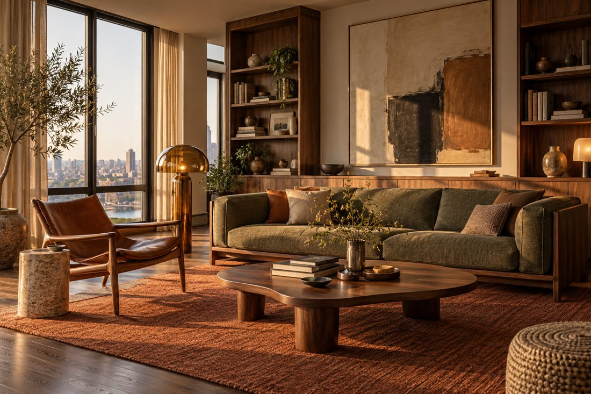
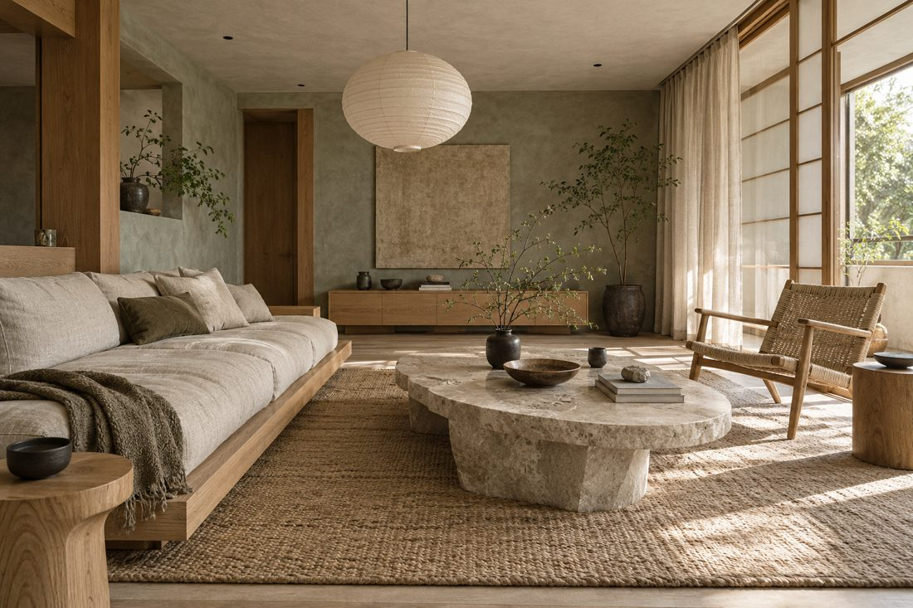
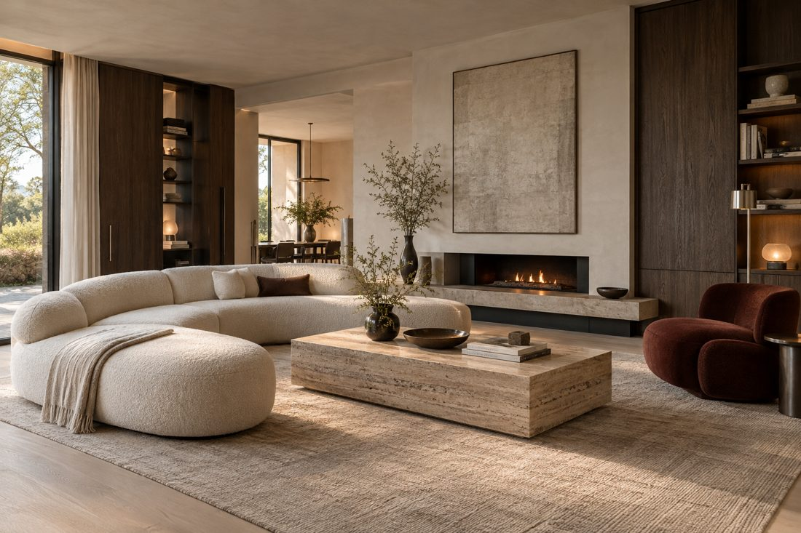
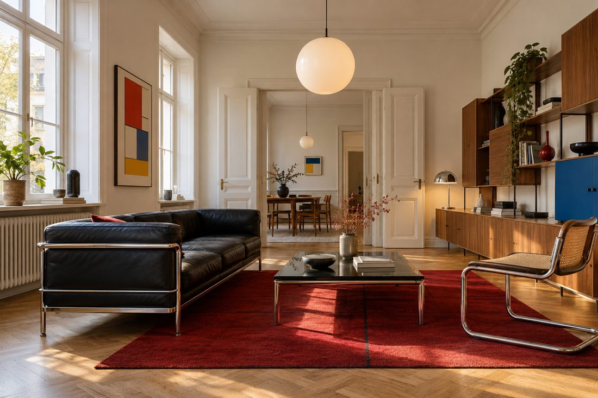
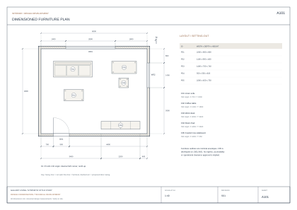
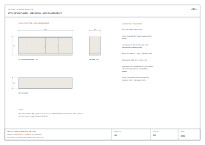
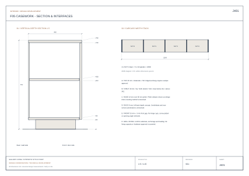
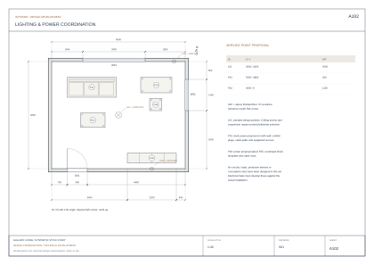

# Interior Design Skill

**講出你想住的樣子，得到看得見的設計，以及能交給設計師與師傅對圖的圖面。**

[English](README.md) · 繁體中文

支援 **Codex、Claude Code、Cursor、GitHub Copilot**。先說需求、風格與預算，agent 會整理設計方向、製作效果圖、空間配置與尺寸圖冊。有圖面或尺寸會更精準；沒有也能先開始。

[](docs/showcase/concepts/mcm/concept.jpg)

*Mid-century Modern／MCM · image gen 生成的設計概念，點圖查看完整尺寸。*

## 一句話開始

> 使用 interior-design skill。我想要兩人住的溫暖 MCM 客廳，有閱讀區、收納和可以工作的角落。喜歡胡桃木、橄欖綠沙發與復古燈具。幫我做效果圖、配置，以及能跟設計師或師傅討論的圖面交付包。尺寸之後可以補。

Agent 負責整理需求、撰寫生圖提示、建立尺寸資料與執行輸出。你不用先寫 JSON 或安裝 Blender 才能開始提案。尚無量測資料時，先產出**標明假設尺寸**的配置與圖面草案；之後提供平面圖、草圖、照片或尺寸，再修到更精準。

**你會拿到：**風格效果圖與材料／家具提案、尺寸配置平面、依專案需求製作的立面／剖面／櫃體詳圖，以及可下載的 PDF／SVG／DXF、表單與施工前確認清單。實際輸出取決於可用工具與專案資料；agent 會說明缺少的能力，不會假稱檔案已產出。

## 四種有個性的設計方向

上方是 MCM，以下呈現另外三種風格。從家具選型、材質、空間構圖到光線，各自有完整設計語言。

| Japandi／日系北歐 | Contemporary／當代現代 | Bauhaus／包浩斯 |
| --- | --- | --- |
| [](docs/showcase/concepts/japandi/concept.jpg) | [](docs/showcase/concepts/contemporary/concept.jpg) | [](docs/showcase/concepts/bauhaus/concept.jpg) |
| 低矮木作、織物與柔和晨光。 | 圓潤量體、鮮明石材與有層次的建築照明。 | 金屬、皮革、幾何色彩與現代主義比例。 |

**這四張皆由 image gen 製作。**它們是獨立風格概念，並非 Blender 渲染，也不代表下方圖面範例的同一個空間。[提示與來源紀錄](docs/showcase/concepts/README.md)可查看生成方式。可重建的 [Blender 範例](skills/interior-design/references/style-studies.md)則保留給可編輯幾何與模型檢查。

## 用實際空間作依據，輕量做出設計效果

**以空間尺寸作為先驗條件，讓 image gen 表現材質、光線與氛圍。** 有尺寸的平面圖、格局輪廓、草圖或簡化模型，都能讓提案有具體起點；有 Blender 基底視角時，直接把低成本基底圖提供給 image gen，作為相機、門窗與家具配置的視覺依據。

這條路徑可減少每次提案都要製作精細展示資產、複雜貼圖，以及執行高採樣本機渲染的負擔。用簡單幾何確認空間，再讓 image gen 發展視覺質感；外觀生成改由圖片服務處理，工具權限、額度及可能費用依平台而定。

1. 建立尺寸、空間輪廓、門窗與家具配置，標明假設尺寸。
2. 固定基底視角，將實際圖片交給支援影像輸入的生圖工具，要求保留相機與空間結構。
3. 對照基底圖，必要時疊圖檢查；門窗移位、比例改變或新增非預期物件時，再修正效果圖。
4. 工程交付圖仍從尺寸模型產生；採用新的視覺設計時，同步更新模型與圖面。

空間依據有助於引導視角與比例，但不代表 image gen 與 Blender 渲染幾何完全一致。用它輕量呈現有說服力的設計效果，精確尺寸則以模型與工程圖為準。詳見[基底圖約束與比對流程](skills/interior-design/references/render-and-imagegen.md)。

## 依成果選擇工具

| 想要的成果 | 使用工具 | 需要的資源 |
| --- | --- | --- |
| 有吸引力的風格效果圖 | Agent 的 image gen 工具 | 不需本機 Blender 或 GPU；工具權限、連線、額度及可能費用依平台而定 |
| 有尺寸的 PDF／SVG／DXF 圖面 | Python 與內附出圖腳本 | 內附圖面產生器不需先跑 Blender 渲染 |
| 可修改的 3D 或忠於模型的視角 | Blender 與其內建 Python | 需要安裝；本機 CPU／GPU 時間及記憶體取決於場景與品質 |
| 可互動的瀏覽器檢視 | 選用的前端 | Node.js 套件與瀏覽器 |

有 image gen 時，優先用它探索外觀；尺寸與施工依據來自幾何及出圖工具。選中的視覺設計需回寫配置／模型，圖面才能對應到它。[完整呈現流程](skills/interior-design/references/render-and-imagegen.md)。

## 實際交付圖面長這樣

以下是另一個可重建的合成圖面範例，從共同空間與櫃體尺寸產出完整 **8 張 A3 圖冊**：尺寸定位、門窗、燈位／插座提案、室內立面、櫃體三視圖、剖面、材料尺寸表及待確認事項。

| 尺寸配置平面 · A101 | 櫃體三視圖 · J301 |
| --- | --- |
| [](docs/showcase/drawings/A101.svg) | [](docs/showcase/drawings/J301.svg) |
| **櫃體剖面與施工介面 · J401** | **燈位與插座提案 · A102** |
| [](docs/showcase/drawings/J401.svg) | [](docs/showcase/drawings/A102.svg) |

**下載交付範例：**[完整 A3 PDF](docs/showcase/drawings/design-coordination.pdf) · [整包 ZIP](docs/showcase/design-development-S01.zip) · [平面 DXF](docs/showcase/drawings/plan.dxf) · [櫃體尺寸表](docs/showcase/drawings/joinery.csv) · [家具表](docs/showcase/drawings/furniture.csv) · [施工前確認清單](docs/showcase/drawings/issues.csv)。

這些是實際生成的圖面。櫃體總寬、總深、板厚、層板標高及內淨尺寸都能回到共同來源核對。真正工程的發行狀態，仍取決於現場尺寸、材料樣品、選定五金與固定基層；合成範例已把這些設計假設和介面分項記錄。

## 安裝到你的 agent

```bash
npx skills add vic4code/interior-design-skill --skill interior-design
```

或在 checkout 內用本機安裝器：

```bash
python3 skills/interior-design/scripts/install_skill.py --agent codex --user
python3 skills/interior-design/scripts/install_skill.py --agent claude-code --user
```

單一專案安裝請把 `--user` 改為 `--project /path/to/project`。安裝器不覆蓋既有安裝。

| Agent | 專案技能路徑 | 啟動方式 |
| --- | --- | --- |
| Codex | `.agents/skills/interior-design` | `$interior-design` |
| Claude Code | `.claude/skills/interior-design` | `/interior-design` |
| Cursor | `.cursor/skills/interior-design` | 請 agent 使用此 skill |
| GitHub Copilot | `.github/skills/interior-design` | 請 agent 使用此 skill |

整個資料夾包含腳本、鎖定依賴、範例、資料格式與 viewer。[相容性與實際驗證狀態](docs/agent-compatibility.md)。

> 請使用 interior-design skill。把這份平面圖與參考風格做成 MCM 客廳、可編輯 Blender 模型，以及詳細的交付圖冊。檢查家具使用、櫃體內淨尺寸和安裝介面；給我實際檔案，並列出還需要現場或產品確認的事項。

## 選用的本機出圖工具

需要 Python 3.11+。選用的前端需要 Node.js 20.19+ 或 22.12+；原生 3D 與離線渲染需要 Blender 4.3+，並將 `blender` 加入 PATH。在安裝後的 skill 資料夾執行，或從 checkout 開始：

```bash
git clone https://github.com/vic4code/interior-design-skill.git
cd interior-design-skill/skills/interior-design
bash scripts/setup.sh
.venv/bin/python scripts/build_drawing_studies.py --out output/my-first-drawing-set
```

開啟 `output/my-first-drawing-set/design-coordination.pdf`，即可看到上面的八張圖面。產生 MCM 原生模型與圖片：

```bash
blender --background --threads 4 --python-exit-code 1 --python scripts/render_style_studies.py -- --style mcm --out output/mcm-study
```

其他選項為 `japandi`、`contemporary`、`bauhaus` 或 `all`。預設使用跨平台 CPU，另提供可選裝置；詳見腳本 `--help` 與[風格流程](skills/interior-design/references/style-studies.md)。

Windows：以 `py -m venv .venv` 建環境，執行 `.venv\Scripts\python -m pip install -r scripts/requirements.lock.txt`，再把指令的 Python 路徑改為 `.venv\Scripts\python`。前端依賴使用 `npm --prefix assets/viewer ci --ignore-scripts`。

## 實際住宅怎麼做

Skill 可以使用專案化 Blender 幾何與資料處理多房、不規則牆、家具旋轉、細緻櫃體與日常操作；依實際圖面／模型核對，保留穩定編號，讓圖面來自同一版資料。[完整空間流程](skills/interior-design/references/advanced-spaces.md)說明這條路徑。

附帶的 `project.py` 是方便重現的小型入門生成器，有它自己的簡化格式與尺寸限制；這些不是 skill 的設計能力上限，詳見[格式說明](skills/interior-design/references/project-format.md)。單靠照片不能取得可靠施工尺寸，仍需校正平面、量測及產品依據。

專業圖面流程會逐步完成總尺寸／尺寸鏈、立面、剖面、板件、材料五金表與工種介面。詳見[施工圖面深化](skills/interior-design/references/construction-documents.md)。實品選物須核對已開啟的原廠資料，並區分原廠模型與尺寸近似。

## 前端檢視與驗證

在 skill 資料夾啟動入門前端：

```bash
.venv/bin/python scripts/project.py build assets/example-project.json --out assets/viewer/public/generated --blender
npm --prefix assets/viewer run dev
```
要在瀏覽器檢視程序建模的 MCM 範例，先產出同版本圖面，再整合渲染成果：

```bash
.venv/bin/python scripts/build_drawing_studies.py --out output/drawing-study
.venv/bin/python scripts/build_style_review.py --study output/mcm-study --drawings output/drawing-study --out assets/viewer/public/generated
```


支援渲染／平面／GLB 檢視與下載。拖拉編輯、任意前端狀態自動回存與完整機電設計仍需相應實作。私人專案留在本機；若另外使用 AI 完工模擬，保留模型原始渲染。

從 repo 根目錄驗證：

```bash
skills/interior-design/.venv/bin/python -m unittest discover -s tests -v
npm --prefix skills/interior-design/assets/viewer run build
```

架構遵循 [Anthropic skill-creator](https://github.com/anthropics/skills/tree/main/skills/skill-creator)：精簡 `SKILL.md`、依需要載入的 references、執行腳本與可重用 assets。[驗證紀錄](docs/verification.md) · [研究及來源](docs/research.md) · [實作規劃](docs/implementation-roadmap.md) · [貢獻方式](CONTRIBUTING.md)。

原創程式與合成資產採 [MIT](LICENSE)。第三方產品模型與圖片須各自記錄授權。Agent／LLM 可能有服務費，本機核心不要求付費圖片 API。
