# Interior Design Skill

**講出你想住的樣子，探索設計，讓完整交付直接在瀏覽器打開。**

[English](README.md) · 繁體中文

[正式版本 v0.1.0](https://github.com/vic4code/interior-design-skill/releases/tag/v0.1.0) · [版本紀錄](CHANGELOG.md)

支援 **Codex、Claude Code、Cursor、GitHub Copilot**。告訴 agent 生活需求、喜歡的風格與要放的東西，它會整理空間提案、製作 image gen 效果圖、準備尺寸圖冊，最後自動開啟同一個本機檢視頁。提供平面圖與量測會更精準；沒有也能先用清楚標示的假設開始。

## 你會得到這五種成果

**從最初配置，到和設計師、施工團隊討論的圖面，全部在同一個瀏覽器頁面。** 下方都是內附合成範例的實際輸出，點圖就能查看原始內容。

<table width="100%">
  <tr>
    <td width="50%" valign="top"><strong>1. 平面圖</strong></td>
    <td width="50%" valign="top"><strong>2. 3D 設計</strong></td>
  </tr>
  <tr>
    <td width="50%" valign="top"><a href="docs/showcase/five-deliverables/layout.svg">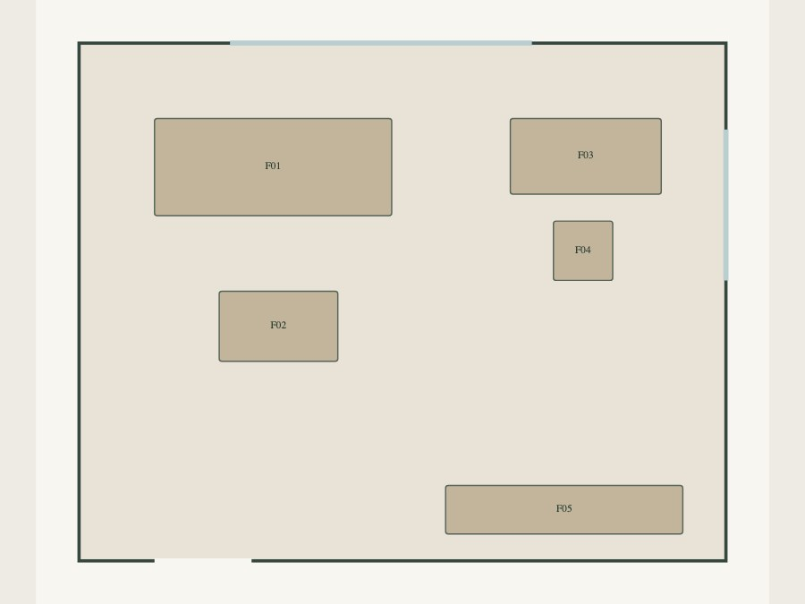</a></td>
    <td width="50%" valign="top"><a href="docs/showcase/five-deliverables/02-3d.jpg"></a></td>
  </tr>
  <tr>
    <td width="50%" valign="top">看懂實際輪廓、家具位置與動線；配置圖保留空間重點，方便先討論怎麼住。</td>
    <td width="50%" valign="top">一開始就看得到室內，可旋轉、縮放；獨立切換白天／夜晚與開燈／關燈。</td>
  </tr>
  <tr>
    <td width="50%" valign="top"><strong>3. 渲染效果</strong></td>
    <td width="50%" valign="top"><strong>4. 機電配置</strong></td>
  </tr>
  <tr>
    <td width="50%" valign="top"><a href="docs/showcase/same-space/mcm/presentation.jpg"></a></td>
    <td width="50%" valign="top"><a href="docs/showcase/drawings/A102.svg">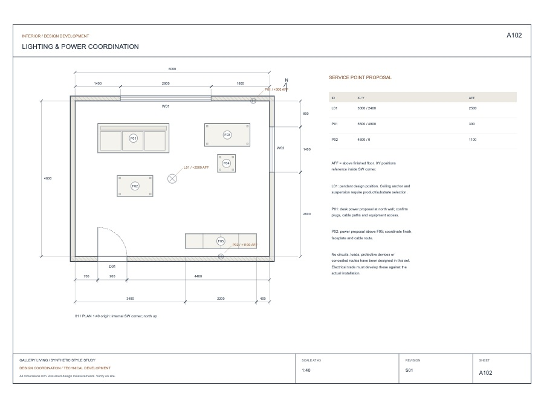</a></td>
  </tr>
  <tr>
    <td width="50%" valign="top">真正使用 image gen，以格局與視角底圖引導材質、家具質感和光線，發展有說服力的設計效果。</td>
    <td width="50%" valign="top">檢視照明、插座位置與高度；提供的空調、給排水資料也會在同一個模式呈現。</td>
  </tr>
  <tr>
    <td width="50%" valign="top"><strong>5. 工程圖面</strong></td>
    <td width="50%" valign="top"><strong>看完，就能把圖帶走</strong></td>
  </tr>
  <tr>
    <td width="50%" valign="top"><a href="docs/showcase/drawings/J301.svg">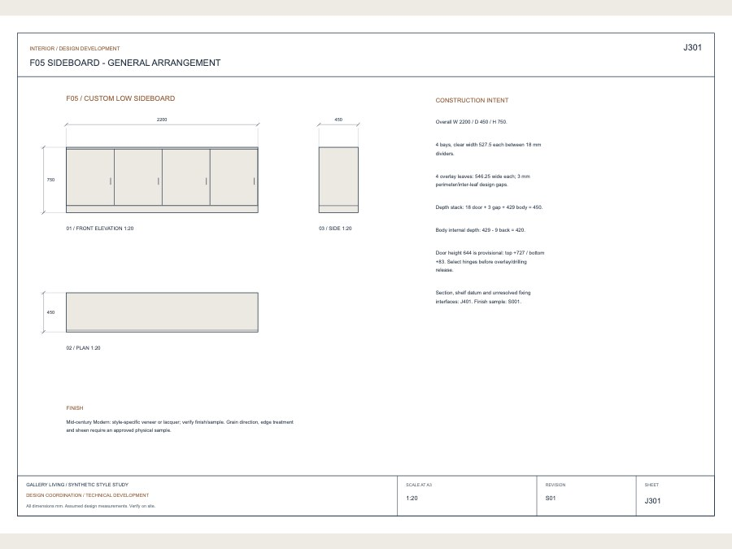</a></td>
    <td width="50%" valign="top" rowspan="2">下載<a href="docs/showcase/drawings/design-coordination.pdf">8 張 A3 圖冊 PDF</a>、各張 SVG、<a href="docs/showcase/drawings/plan.dxf">可編輯平面 DXF</a>及<a href="docs/showcase/drawings/joinery.csv">櫃體尺寸表</a>。<br><br>五種模式共用一個瀏覽器頁面與同一版設計。配置圖回答「東西放哪裡」，工程圖回答「尺寸、高度和接合怎麼做」。</td>
  </tr>
  <tr>
    <td width="50%" valign="top">用尺寸平面、立面、剖面和櫃體詳圖討論高度、材料與組裝；點開原圖即可放大看。</td>
  </tr>
</table>

Agent 依各房間的**實際多邊形面積或提供面積、用途與設計重點**，在約定圖片數量內安排視角。大空間、多用途空間會有更完整的涵蓋；實際生成完成的圖片才會進入圖庫。

既有多房、不規則的原生專案保留自己的幾何、圖號與已知量測；矩形入門生成器是選用工具，未知尺寸保持未知。公開機電範例是照明／插座提案；完整迴路、空調與給排水設計需要對應資料及專業工種覆核。

## 同一個空間，四種風格

保留同一個合成空間、門窗、家具配置與基底視角，透過 image gen 比較四種方案。預覽圖統一為 **900 × 675**，尺寸與比例一致。

<table width="100%">
  <tr>
    <td width="50%" valign="top"><strong>Mid-century Modern</strong></td>
    <td width="50%" valign="top"><strong>Japandi</strong></td>
  </tr>
  <tr>
    <td width="50%" valign="top"><a href="docs/showcase/same-space/mcm/presentation.jpg">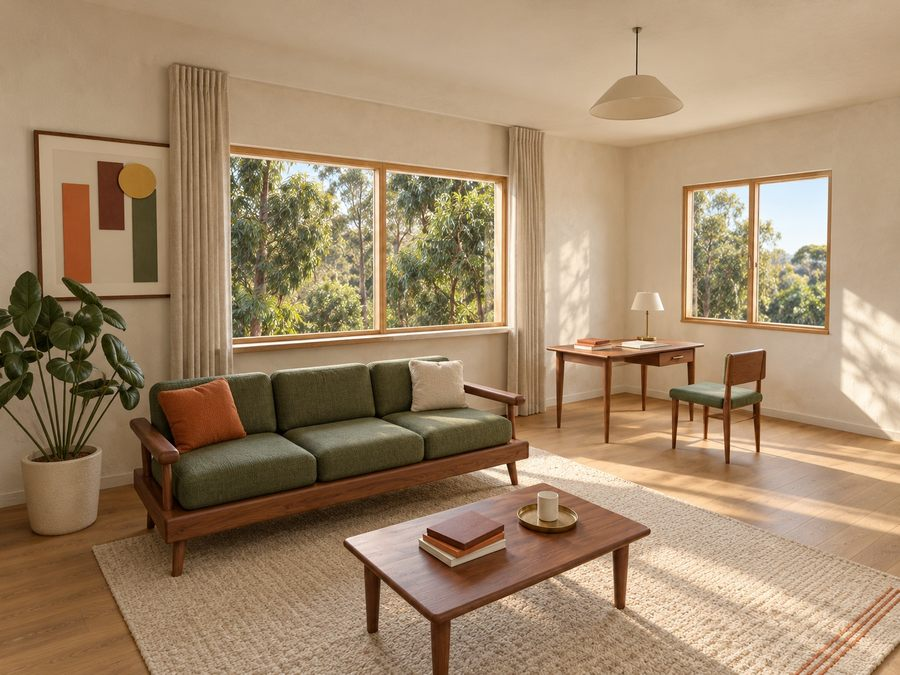</a></td>
    <td width="50%" valign="top"><a href="docs/showcase/same-space/japandi/presentation.jpg">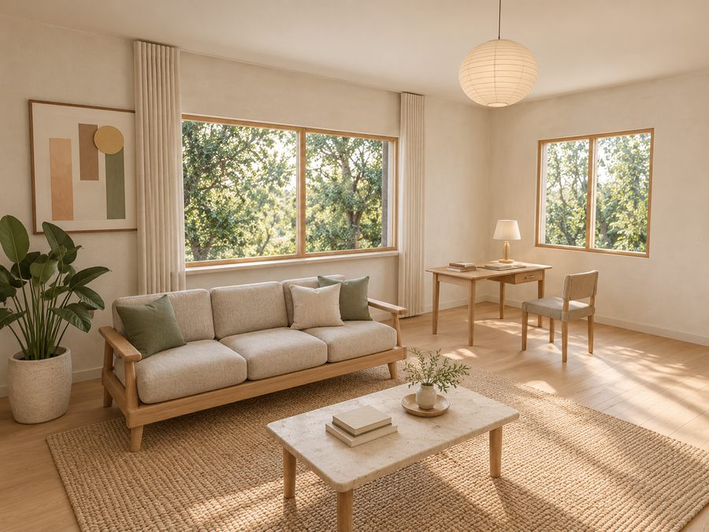</a></td>
  </tr>
  <tr>
    <td width="50%" valign="top">胡桃木、橄欖綠與溫潤復古比例。</td>
    <td width="50%" valign="top">淺木、織物與安靜的自然色調。</td>
  </tr>
  <tr>
    <td width="50%" valign="top"><strong>Contemporary</strong></td>
    <td width="50%" valign="top"><strong>Bauhaus</strong></td>
  </tr>
  <tr>
    <td width="50%" valign="top"><a href="docs/showcase/same-space/contemporary/presentation.jpg">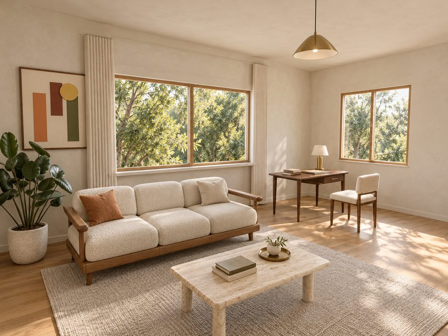</a></td>
    <td width="50%" valign="top"><a href="docs/showcase/same-space/bauhaus/presentation.jpg">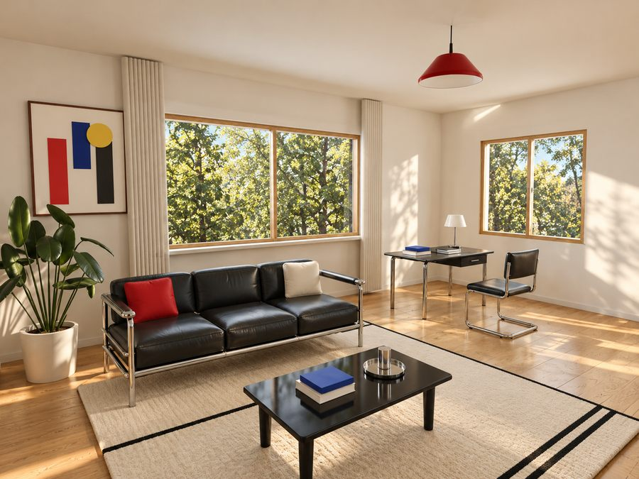</a></td>
  </tr>
  <tr>
    <td width="50%" valign="top">圓潤量體、觸感布料與石材。</td>
    <td width="50%" valign="top">金屬管架、黑皮革與幾何色彩。</td>
  </tr>
</table>

這四張**確實以同一張底圖作為 image gen 輸入**，不是四個無關的房子。可比較[模型底圖](docs/showcase/same-space/base.jpg)與[生成紀錄](docs/showcase/same-space/README.md)。生成圖用來發展外觀，家具與表面細節可能偏移；尺寸與技術細節仍以來源模型為準，採用變更後須回寫模型才能發行製作。

## 3D 裡直接比較光線

**在真正的 3D 模型裡，直接看光線怎麼變。** 白天／夜晚與室內燈開／關可以獨立切換。白天關燈保留自然採光，夜間開燈則看局部暖光與陰影。這四張都是瀏覽器中的實際畫面，共用同一個靜止視角與 **900 × 675 px** 畫布。

<table width="100%">
  <tr>
    <td width="50%" valign="top"><strong>白天 · 開燈</strong></td>
    <td width="50%" valign="top"><strong>白天 · 關燈</strong></td>
  </tr>
  <tr>
    <td width="50%" valign="top"><a href="docs/showcase/lighting-3d/day-on.jpg">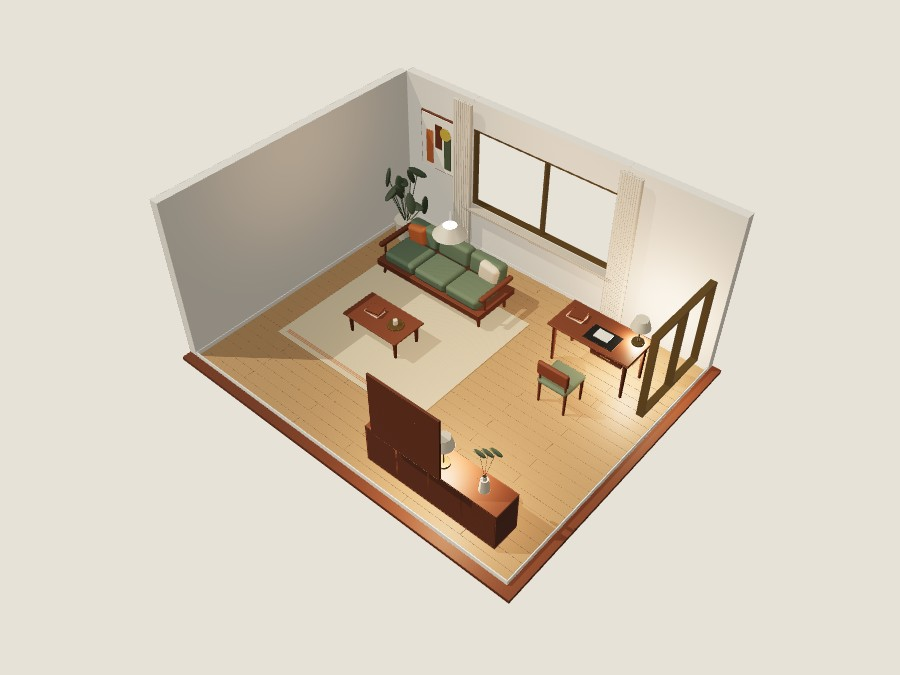</a></td>
    <td width="50%" valign="top"><a href="docs/showcase/lighting-3d/day-off.jpg">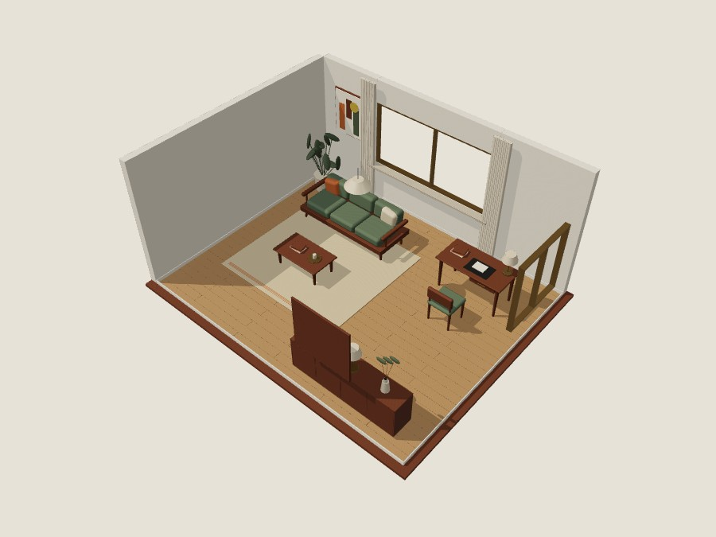</a></td>
  </tr>
  <tr>
    <td width="50%" valign="top"><strong>夜晚 · 開燈</strong></td>
    <td width="50%" valign="top"><strong>夜晚 · 關燈</strong></td>
  </tr>
  <tr>
    <td width="50%" valign="top"><a href="docs/showcase/lighting-3d/night-on.jpg">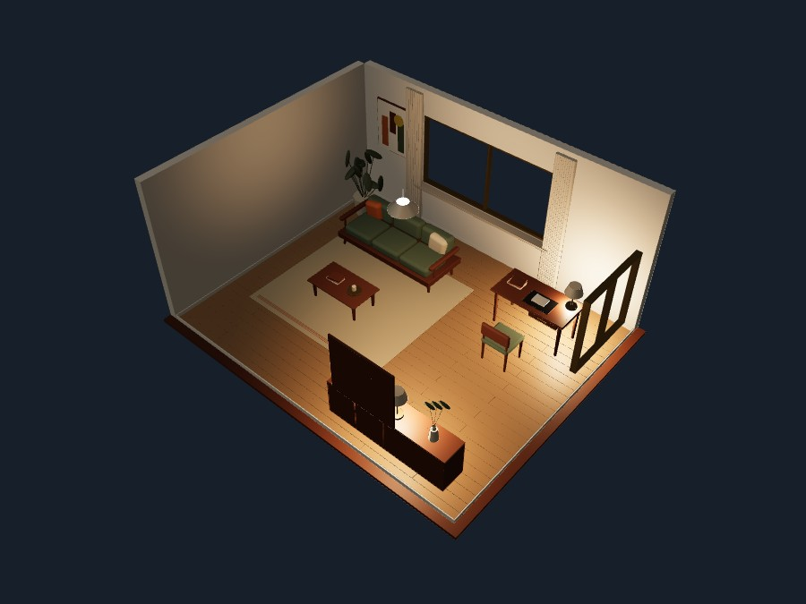</a></td>
    <td width="50%" valign="top"><a href="docs/showcase/lighting-3d/night-off.jpg">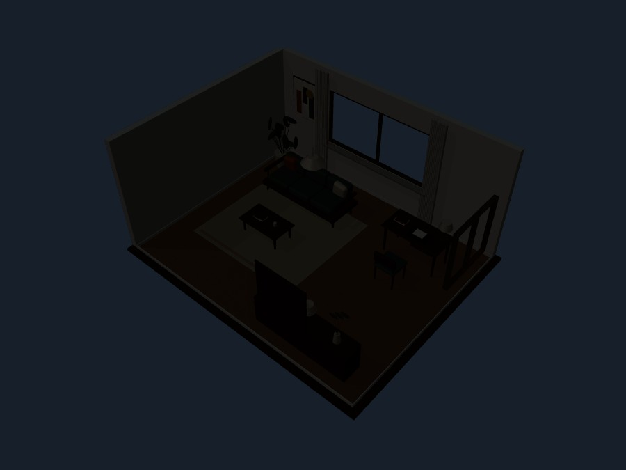</a></td>
  </tr>
</table>

[3D 實際截圖與來源紀錄](docs/showcase/lighting-3d/README.md)。快速預覽用來討論設計氛圍；燈具規格與工程計算仍由機電流程確認。

## Image gen 寫實效果的光線比較

同一個 MCM 空間、同一個視角，實際用 **image gen 製作三種光線情境**。日光與人工照明分開控制，白天關燈仍看得到窗外自然光帶來的空間層次。

<table width="100%">
  <tr>
    <td width="33%" valign="top"><strong>白天 · 關燈</strong></td>
    <td width="33%" valign="top"><strong>白天 · 開燈</strong></td>
    <td width="33%" valign="top"><strong>夜晚 · 開燈</strong></td>
  </tr>
  <tr>
    <td width="33%" valign="top"><a href="docs/showcase/lighting/day-off/presentation.jpg">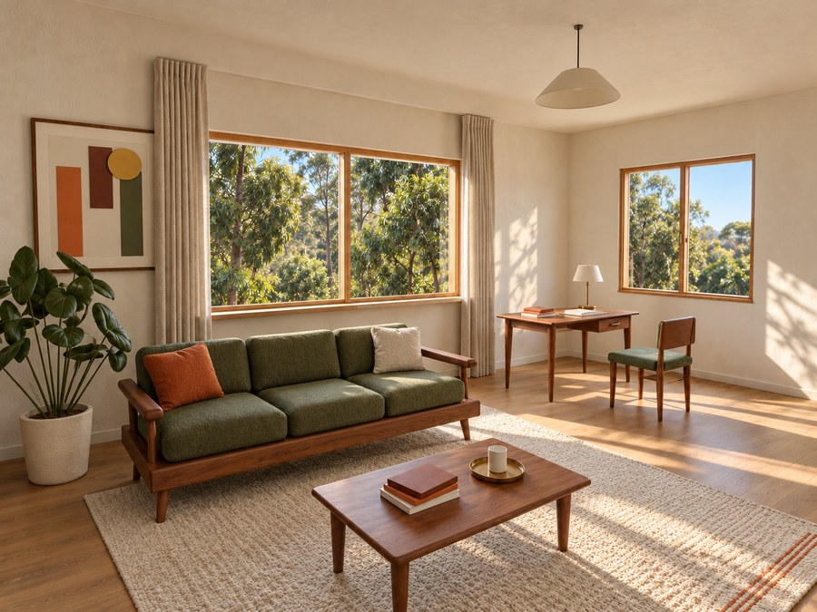</a></td>
    <td width="33%" valign="top"><a href="docs/showcase/lighting/day-on/presentation.jpg">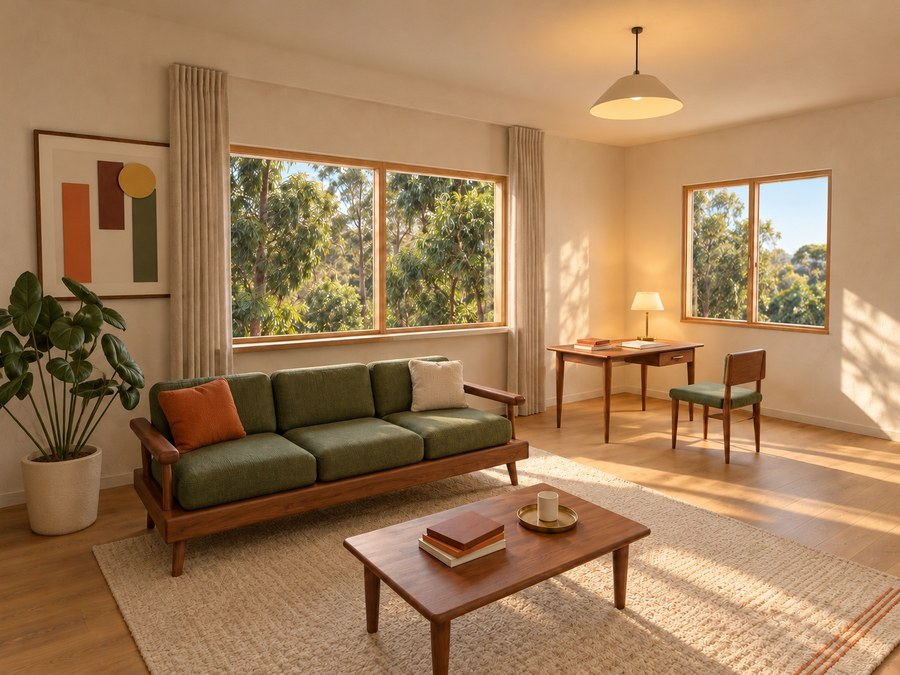</a></td>
    <td width="33%" valign="top"><a href="docs/showcase/lighting/night-on/presentation.jpg">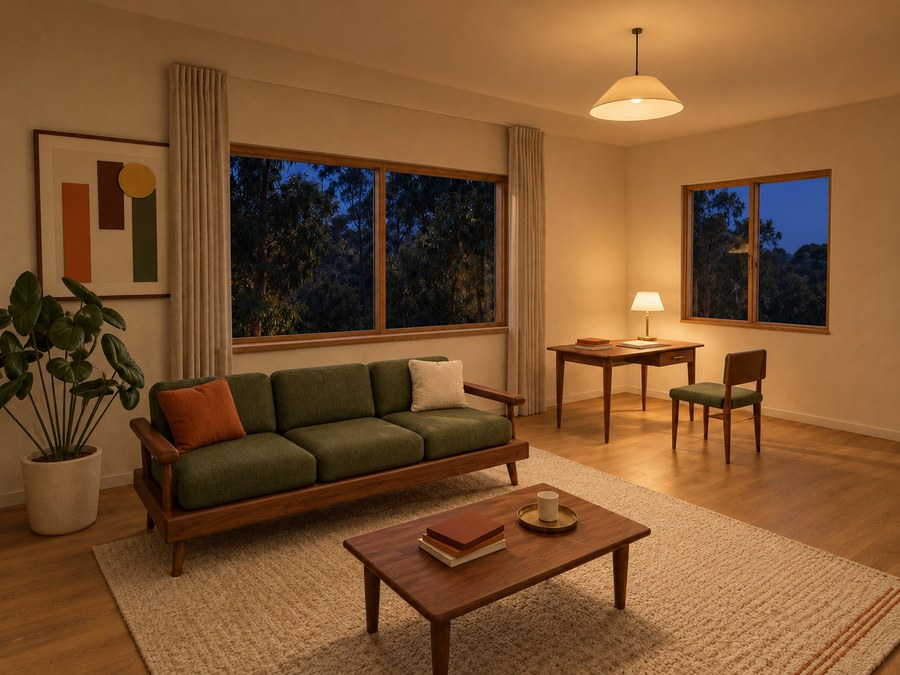</a></td>
  </tr>
</table>

每次 prompt 都寫入相同的 **4:3 畫布、水平相機、垂直建築線、視野、裁切與家具位置**，只改指定的光線條件。預覽圖統一為 **900 × 675 px**。[生成提示與紀錄](docs/showcase/lighting/README.md)保留輸入及覆核結果。互動 3D 也能快速切換白天／夜晚、開燈／關燈；這是氛圍預覽，照度計算仍需另行驗證。

## 從需求開始使用

```bash
npx skills add vic4code/interior-design-skill --skill interior-design
```

> 使用 interior-design。我想要溫暖客廳，有閱讀區、收納和工作角落。用同一個格局比較 MCM、Japandi 和 Bauhaus，安排足夠的 image gen 視角呈現各區，也要比較白天關燈與暖光開燈，圖片尺寸和視角統一。給我平面配置、互動 3D、可用的機電協調與尺寸圖冊，完成後全部在瀏覽器打開。平面圖與量測之後可以補。

Agent 負責整理資料與執行工具；有舊專案就使用舊專案。尺寸不足時會列明假設與下一步量測。可交付項目取決於平台的圖片／模型工具與專案資料；[Host 相容性](docs/agent-compatibility.md)分開記錄安裝檢查與實際流程測試。

## 實際可下載的圖面

可重現的合成 **8 張 A3 範例**，共用空間尺寸與各風格材料色調，包含家具配置、照明插座提案、兩向室內立面、櫃體三視圖、櫃體剖面、材料門窗表，以及圖目錄／待確認事項。

[完整 PDF](docs/showcase/drawings/design-coordination.pdf) · [交付 ZIP](docs/showcase/design-development-S01.zip) · [平面 DXF](docs/showcase/drawings/plan.dxf) · [櫃體尺寸表](docs/showcase/drawings/joinery.csv) · [施工前確認事項](docs/showcase/drawings/issues.csv)。

實際專案圖冊應有用途標籤、室內尺寸鏈、門窗、剖面詳圖索引、構件資訊及材料五金決策，不能只有模型輪廓與外框尺寸。模型衍生的協調圖，仍需完成現場、產品、固定方式與工種覆核，才能發行施工／製作版本。

## 直接試用完整範例

在 checkout 中使用單一入口，產出四種風格並**自動開啟瀏覽器**：

```bash
cd skills/interior-design
bash scripts/setup.sh
.venv/bin/python scripts/interior_design.py demo --out /path/to/my-design
```

輸出整理在 `drawings/` 與 `review/`。範例內附以基底圖生成的效果圖與對應範例幾何，不呼叫付費圖片 API，也不需跑 Blender 渲染。真正的新方案由 agent 使用平台的 image gen 工具製作；平常由 agent 替你執行流程，這些指令也可直接本機試用。

Python 3.11+ 執行出圖工具，Node.js 建置前端；Blender 4.3+ 僅用於原生模型擷取／建模與選用的模型渲染。Image gen 需要平台工具或已設定的服務，權限、額度與可能費用依服務而定。簡化幾何與基底視角可減少精細材質與本機渲染工作，但不保證生成圖與 Blender 幾何完全一致。

Windows：用 `py -m venv .venv` 建立環境，以 `.venv\Scripts\python -m pip install -r scripts/requirements.lock.txt` 安裝依賴，再使用該 Python 執行單一入口。

## 可攜、清楚的 skill 結構

`SKILL.md` 負責主流程，`references/` 依需要載入細節，`assets/` 放範例資料、前端，以及內附的 **Taste + UI UX Pro Max** 指引與搜尋依賴。`scripts/interior_design.py` 是唯一入口，內部實作集中在 `scripts/_internal/`。

[整合檢視流程](skills/interior-design/references/browser-review.md) · [既有原生專案](skills/interior-design/references/native-handoff.md) · [設計依賴](skills/interior-design/references/design-dependencies.md) · [Host 相容性](docs/agent-compatibility.md) · [驗證紀錄](docs/verification.md) · [貢獻方式](CONTRIBUTING.md)。

原創程式與合成資產採 [MIT](LICENSE)。內附依賴保留其授權，詳見[第三方聲明](skills/interior-design/THIRD_PARTY_NOTICES.md)。不包含私人專案內容。
